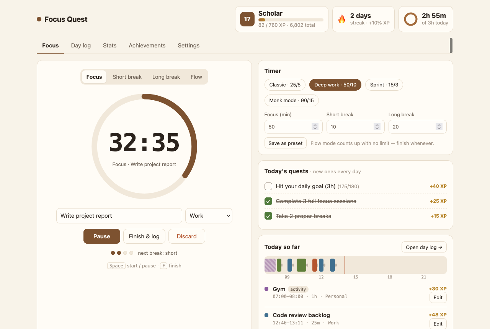
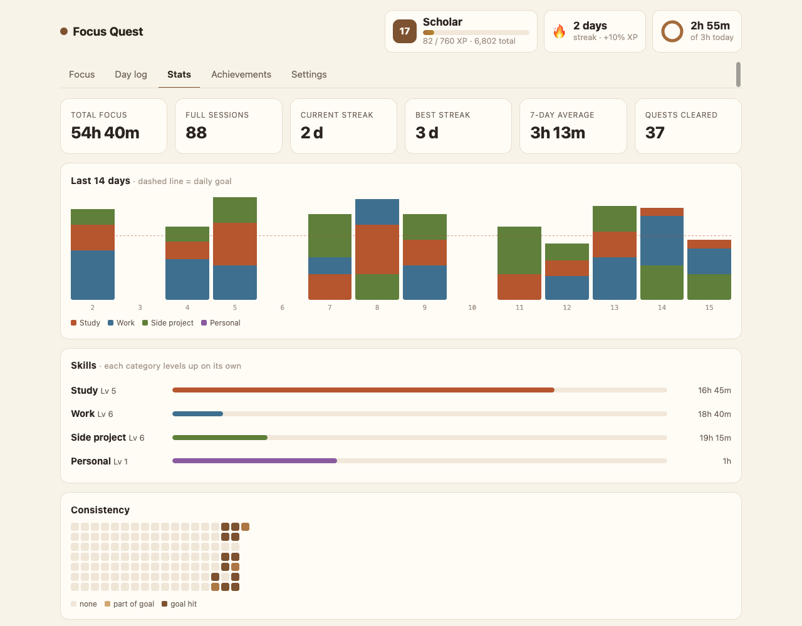

# Focus Quest

A focus timer and day log with a game layer: XP, levels, streaks, daily quests and achievements.

**Use it now → https://rishidhar86.github.io/focus-quest/**

No account and no sign-up. Everything you log stays in your own browser, and nothing is sent anywhere.

## What it does

- **Custom timer.** Set any focus, short-break and long-break length and save combinations as presets. Four come built in: Classic 25/5, Deep work 50/10, Sprint 15/3 and Monk mode 90/15. **Flow** mode counts up with no limit.
- **Day log.** After each session, write a line about what you got done. A timeline shows your day coloured by category. You can also log things you did without the timer, like a class, the gym or a meeting.
- **XP and levels.** Earn 1 XP per focused minute, plus a bonus for finishing a full session. Levels go from *Wanderer* up to *Legend*.
- **Streaks.** Hit your daily goal on consecutive days. Each streak day adds +5% XP, up to +50%.
- **Daily quests.** "Hit your goal" every day, plus two quests that change daily, such as a 45-minute block, notes on 3 sessions, or starting before 10:00.
- **Skills.** Each category levels up separately.
- **Achievements.** 20 to unlock, such as Deep Diver, Night Owl and Centurion.
- **Stats.** A 14-day chart, a consistency heatmap and your totals.
- **Your own sounds.** Pick a built-in chime or upload any audio file for the end of focus sessions and breaks.
- **Keyboard shortcuts.** <kbd>Space</kbd> starts or pauses, <kbd>F</kbd> finishes and logs.

## Install it

**On a computer:** open the link above and bookmark it. In Chrome or Edge you can also use *Install app* in the address bar.

**On an iPhone:** open the link in **Safari**, then tap Share → **Add to Home Screen**. It opens full-screen like an app and works offline.

**Offline, from a file:** download this repo (Code → Download ZIP) and open `index.html` in any browser.

## Good to know

- **Your data lives in your browser.** Clearing site data, or deleting the home-screen app, erases it. Use **Settings → Export JSON** now and then to keep a backup. You can import it again on any device.
- **iPhone timers pause in the background.** iOS pauses web apps when they're closed or the phone is locked. The session is still logged with the right time when you come back, but the chime only plays while the app is on screen. *Keep the screen awake* is on by default, and the silent switch mutes the chime.
- Change categories, your daily goal and break rhythm in **Settings**.

## Under the hood

The app is one HTML file of plain JavaScript, with no build step and no dependencies. A small service worker lets it run offline. XP, quests and achievements are all recalculated from your log, so if you edit or delete an entry, your XP updates to match.
